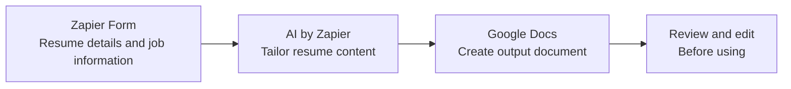

# Resume Tailoring Assistant

A no-code workflow that uses Zapier Forms, AI by Zapier, and Google Docs to create a job-tailored resume draft from form inputs.

## Workflow

## How it works

1. A user submits the form with the information needed for a tailored draft.
2. AI by Zapier uses the submitted information to generate the draft.
3. The workflow creates a Google Doc with the result.
4. The user reviews and edits the document before using it.

## Tools

- **Zapier Forms** — collects the workflow inputs.
- **AI by Zapier** — generates tailored resume content.
- **Google Docs** — stores the generated draft.

## Setup overview

1. Create a form with fields for the resume information and job details you want to use.
2. Create a Zap that starts when the form is submitted.
3. Add an AI by Zapier step and map the relevant form responses into its instructions.
4. Add a Google Docs step to create a document from the AI output.
5. Test with sample information and review the generated document.

Exact field names and mappings depend on your own Zap configuration.

## Privacy

This repository documents the workflow only. Do not commit resumes, personal information, job descriptions, generated documents, credentials, Zapier webhook URLs, or private Google Docs links. Keep real workflow inputs and outputs in the services where you manage them.

## Notes

This is a no-code automation project. The repository contains documentation and a workflow diagram; it does not contain executable application code.
